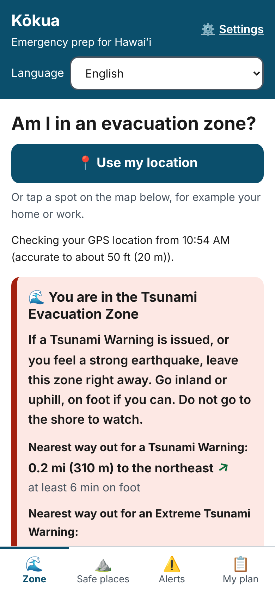
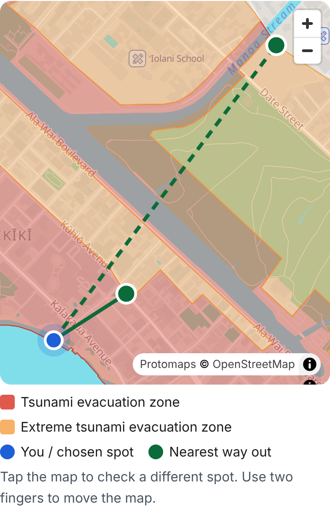
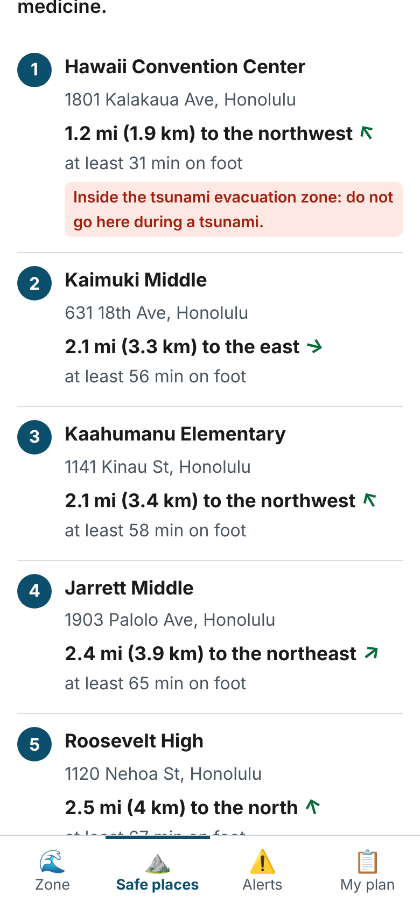
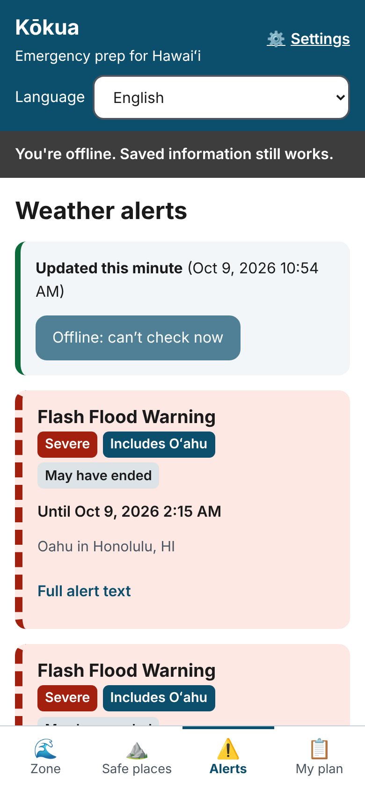
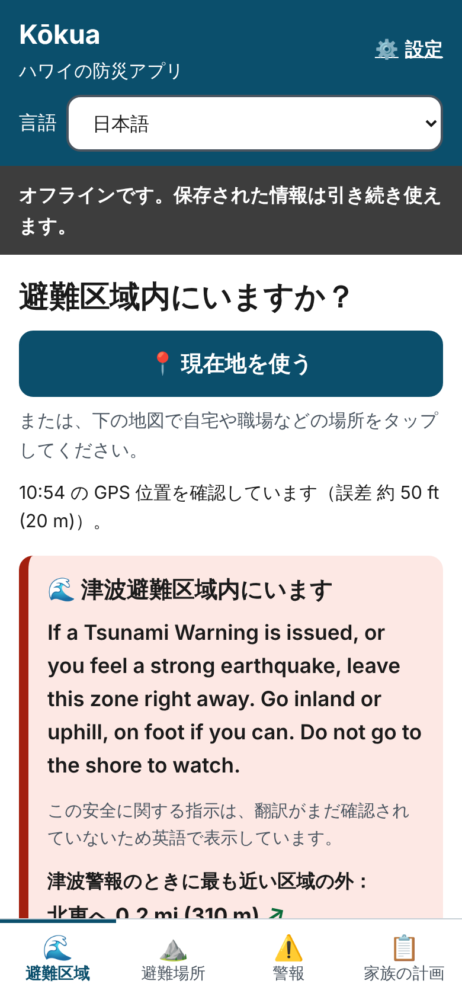
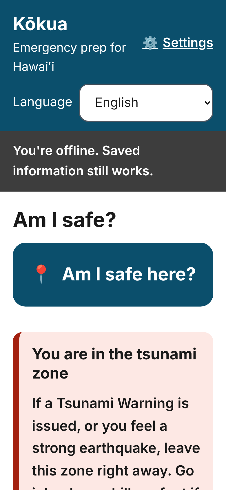
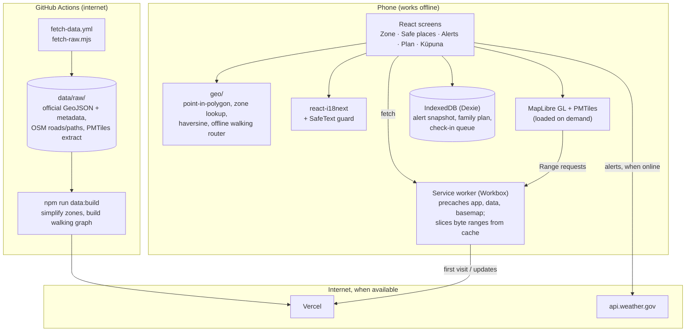

# Kōkua

**Offline-first, multilingual emergency preparedness for Hawaiʻi.**

During hurricanes, tsunamis and wildfires, cell service and power often fail exactly when
people need information most, and many Hawaiʻi residents are more comfortable in a
language other than English. Kōkua is an installable web app that keeps working with zero
connectivity. It tells you whether you're in a tsunami evacuation zone, the nearest way
out, where the hurricane refuge areas are, what alerts were last issued and how old they
are, and what your family's plan is, in your language.

> Built end to end by Claude Code (an AI coding agent) at Skylor Chan's direction, as a
> test of what an AI agent can build. See [`AI_USAGE.md`](AI_USAGE.md). It is not a
> Congressional App Challenge submission.

| Zone check (GPS, offline)                                                                                                                                                     | Way out on the map                                                                                                                                                | Nearest refuge areas                                                                                                                                                 |
| ----------------------------------------------------------------------------------------------------------------------------------------------------------------------------- | ----------------------------------------------------------------------------------------------------------------------------------------------------------------- | -------------------------------------------------------------------------------------------------------------------------------------------------------------------- |
|  |  |  |

| Alerts, in airplane mode                                                                                                                          | Japanese, in airplane mode                                                                                                                                                         | Kūpuna mode, extra-large text                                                                                          |
| ------------------------------------------------------------------------------------------------------------------------------------------------- | ---------------------------------------------------------------------------------------------------------------------------------------------------------------------------------- | ---------------------------------------------------------------------------------------------------------------------- |
|  |  |  |

## What it does

| Feature                                                                                                                                                         | Works offline   |
| --------------------------------------------------------------------------------------------------------------------------------------------------------------- | --------------- |
| **Am I in an evacuation zone?** GPS or tap on the map, checked against official zone polygons                                                                   | ✅              |
| **Nearest way out** for a Tsunami Warning and for an Extreme Tsunami Warning, as a **walking route** along real streets and paths, with turn-by-turn directions | ✅              |
| **Hurricane refuge areas**: the 5 nearest by walking distance, with routes, flagging any that sit inside a tsunami zone                                         | ✅              |
| **Offline map of Oʻahu** (streets, place names, zones), 11 MB, cached on first visit                                                                            | ✅              |
| **NWS alerts** for Hawaiʻi: live when online, last copy offline, always labelled with its age                                                                   | ✅ (saved copy) |
| **Share alerts phone to phone** by QR code or text-message link, with no internet or server                                                                     | ✅              |
| **Family plan**: household, home location, meeting places, contacts, 14-day kit checklist                                                                       | ✅              |
| **Print or QR** the family plan (one page)                                                                                                                      | ✅              |
| **"I'm safe" check-in**: a queued message sent by your phone's SMS app (no data needed)                                                                         | ✅              |
| **10 languages** with a safety-translation guard                                                                                                                | ✅              |
| **Accessibility**: large and extra-large text, high contrast, kūpuna (one-screen) mode                                                                          | ✅              |

## What it deliberately doesn't do

- **Routes don't know about closures, flooding or damage.** Walking routes follow
  OpenStreetMap's roads and paths as mapped, and the app says to follow evacuation signs
  and officials. Where no route is found (far from any path), it falls back to a
  straight line and labels it.
- **No "this shelter is open" status.** The City's refuge layer has internal status fields
  with no published meaning, so Kōkua drops them. It always says refuges open only when
  officials announce it.
- **No offline address search.** Geocoding needs a server. Use GPS, tap the map, or save
  your home location in the plan.
- **No invented translations.** Chuukese and Marshallese are listed but stay in English
  until a native speaker can translate. See [Translations](#translations).
- **Oʻahu only** for zones, refuges and the map. Alerts cover the whole state.

## Architecture



### Key design decisions

- **Offline walking routes, on the phone.** An online routing service would fail exactly
  when it matters. The build turns OpenStreetMap's roads, footpaths and stairs on Oʻahu
  (about 7,000 km; no freeways, nothing marked no-foot or private) into a 3 MB graph of
  86,000 intersections, each tagged with its tsunami zone. The phone snaps you to the
  nearest path and runs Dijkstra's algorithm until it reaches the first intersection on
  safe ground: the nearest way out _by walking_, which isn't always the one nearest as
  the crow flies. Routes take a few milliseconds; refuges are ranked by walking distance
  in one search ([`src/geo/route.ts`](src/geo/route.ts),
  [`scripts/data/build-graph.mjs`](scripts/data/build-graph.mjs)).
- **"Nearest way out" aims at safe ground, not the zone edge.** The seaward edge of a
  tsunami zone is the shoreline, so "nearest edge of the zone you're in" pointed into the
  ocean from Waikīkī. Kōkua measures to the nearest point of a polygon you should go
  _to_: extreme or safe zones for a Tsunami Warning, safe zones for an Extreme Tsunami
  Warning. You're outside those polygons, so their closest point is always on a boundary,
  and checking boundary segments is exact ([`src/geo/nearest.ts`](src/geo/nearest.ts)).
- **"Not on mapped land" instead of a false "safe".** The official tsunami, extreme and
  safe zones tile Oʻahu's land with no overlap. A point in none of them is in the ocean or
  off the island, and Kōkua says so rather than calling it safe.
- **Basemap byte ranges from the cache.** MapLibre reads the PMTiles basemap in small
  `Range` requests. Workbox's precache would answer with the whole 11 MB file, so the
  service worker slices the cached copy into proper `206` responses
  ([`src/sw.ts`](src/sw.ts)).
- **Fast first screen on a cheap phone.** The map (a 1 MB library plus WebGL) and the
  1 MB zone file load only once there's a location to check or the user taps "Show the
  map". Lighthouse mobile performance went from 54 to 96. The walking graph loads the
  same way, after the zone answer is on screen.
- **Safety-translation guard.** Every non-English string is flagged `machine` or
  `reviewed` in [`translation-status.json`](src/i18n/translation-status.json). Safety
  instructions (`safety.*`) appear in another language only after human review. Until
  then the English original shows, with a note in the reader's language.
- **Updates never interrupt.** A new version waits for the user to tap "Reload".
- **Shared alerts are never trusted.** Anyone can make a QR code, so alerts from another
  phone are shown read-only, marked "can't verify", and never replace the phone's own NWS
  data.
- **No accounts, no tracking, no API keys.** Everything personal stays on the device.

## Translations

| Language                                                   | Status                                                                                                                           |
| ---------------------------------------------------------- | -------------------------------------------------------------------------------------------------------------------------------- |
| English                                                    | Source                                                                                                                           |
| 日本語, 한국어, 中文（繁體）, Tiếng Việt, Tagalog, Ilokano | Full UI, machine-translated by the AI, **not yet reviewed**                                                                      |
| ʻŌlelo Hawaiʻi                                             | Short labels only (navigation, compass, buttons), not yet reviewed                                                               |
| Chuukese, Marshallese                                      | Listed, English for now. The AI's knowledge of these languages isn't reliable enough for emergency text, so nothing was guessed. |

Native-speaker review is the most valuable contribution anyone could make to this
project. A reviewer flips entries in `translation-status.json` to `reviewed` with their
name and the date, and the matching safety instructions start appearing in that language.

## Quality

| Check                              | Result                                                                                                                                                                                                                                                                  |
| ---------------------------------- | ----------------------------------------------------------------------------------------------------------------------------------------------------------------------------------------------------------------------------------------------------------------------- |
| Unit tests (Vitest)                | 100 passing: geometry (synthetic and real Oʻahu zones), walking router (synthetic grids, and real streets: every route ends on safe ground and is never shorter than the straight line), alert parsing (real NWS feed), staleness, share codec, translations, UI guards |
| End-to-end (Playwright, Pixel 5)   | 11 passing, including a full **airplane-mode run**: zone check by GPS, refuges, cached alerts, family plan surviving a restart, language switch, basemap range requests served from cache                                                                               |
| Accessibility                      | axe-core WCAG 2.1 A/AA on every screen (normal, high contrast, kūpuna, Japanese): 0 violations. No sideways scrolling at 320 px wide at any text size                                                                                                                   |
| Lighthouse (mobile, local preview) | Performance 96, Accessibility 100, Best Practices 100, SEO 100                                                                                                                                                                                                          |
| Print                              | The family plan prints on one Letter page                                                                                                                                                                                                                               |

Not yet done: testing on a real low-end Android phone, and review of any translation by
a native speaker.

## Development

Requires Node 22.

```bash
npm install
npm run data:build   # raw downloads in data/raw/ -> public/data/ and public/map/
npm run dev          # dev server (no service worker)
npm run build        # production build (runs data:build first)
npm run preview      # serve the build at http://localhost:4173/
npm run lint         # ESLint, including jsx-a11y
npm run typecheck
npm test             # unit tests
npm run e2e          # Playwright: airplane mode, accessibility, install criteria
npm run i18n:sync    # flag new translated strings as "machine"
```

**Refreshing the data.** The raw datasets are downloaded on a GitHub runner: run the
**Fetch raw data** workflow from the Actions tab, or push a change to
`scripts/data/fetch-raw.mjs`. It commits the results to `data/raw/`; then run
`npm run data:build`.

**Testing offline by hand.** `npm run build && npm run preview`, open the site in Chrome,
wait for "ready to work offline", then DevTools → Network → Offline, and reload.

**Deploying.** Hosted on Vercel, configured by [`vercel.json`](vercel.json): Vercel builds
with `npm run build` (which runs `data:build` first) and serves `dist/` from the domain
root. Connect the GitHub repo in Vercel once and every push to `main` deploys, and every
other branch gets a preview URL. Private repos work on Vercel's free plan.

## Data sources

See [`DATA_SOURCES.md`](DATA_SOURCES.md) for URLs, licenses and dates. In short: tsunami
zones from the Hawaiʻi Statewide GIS Program (Oʻahu zones by the City & County of
Honolulu, April 2025); hurricane refuge areas from Honolulu's Department of Emergency
Management; alerts from the National Weather Service; the basemap from OpenStreetMap via
Protomaps. The app shows each dataset's "updated" and "downloaded" dates with the data.

## Disclaimer

Kōkua is a preparedness aid, not an official warning system. Zone lines are approximate.
Always follow instructions from emergency officials.
